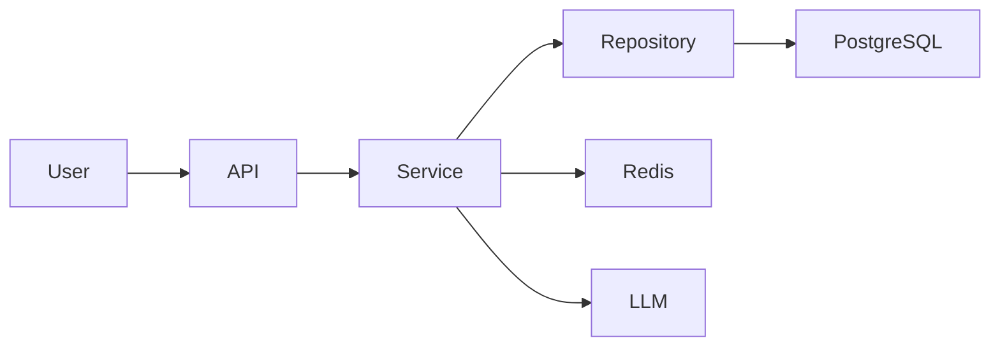

# dsh-project-brain 產品需求文件

**專案名稱：** dsh-project-brain
**產品定位：** DSH 的持久化專案大腦（Local-First / 專案繫結 / 跨 Session 續接）
**版本：** v0.3.8（實現）/ 需求基線 v0.1
**狀態：** v0.3.8 已就緒，等使用者重啟 DSH 後做最終驗證
**目標使用者：** 使用 DSH 進行長期軟體開發的個人開發者與開發團隊

---

## 0. 實現狀態（v0.3.8 vs PRD v0.1）

### 已交付（P0 + P0.5 全部完成）

| PRD 章節 | 需求 | 狀態 |
| --- | --- | --- |
| §2.1 Project Understanding | 自動分析專案結構 | ✅ scanner + build-time embed |
| §2.2 Persistent Project Memory | 專案級持久化記憶 | ✅ Memory V2 JSONL + active 狀態過濾 + BM25/可選向量 Top-K |
| §2.3 Cross-Session Continuity | 跨 Session 續接 | ✅ Context Injector + project_continue |
| §2.4 Project Evolution | 持續演進 | ✅ Session 摘要（git diff） + 每次 update 寫 timeline |
| §4.1 Project Overview | 專案元資訊（名/型別/更新時間） | ✅ Header 區塊 |
| §4.2 Tech Stack | 自動識別（Express/FastAPI/...） | ✅ scanner techStack 檢測 |
| §4.3 Directory Explorer | 重要目錄 | ✅ topLevel 列表 |
| §4.4 SidebarPreview | 側邊欄常駐入口 + 5 區塊 + Onboarding + 行動按鈕 | ✅ **8 區塊**（超出原設計）+ 摺疊 Dashboard |
| §5 Architecture | 系統架構圖 | ✅ SidebarPreview CodeGraph 區塊（區域性版本） |
| §13 Session 摘要 | Session 結束自動歸檔 | ✅ summarizer |
| §14 Memory Lifecycle | importance + 合併/淘汰 | ✅ + project_dream light 模式 |

### 調整/延期（與原 PRD 的偏差）

| 偏差 | 原因 | 狀態 |
| --- | --- | --- |
| 資料儲存改用 **JSONL** 而非 SQLite | Local-First + git 友好 + 零依賴；規模未到 SQLite 閾值 | ✅ 調整 |
| 移除 SQLite / better-sqlite3 / storage-domain | 同上 | ✅ 調整 |
| SidebarPreview 5 區塊 → **8 區塊** | 實測發現 P0.4.1 加 TODO Top3 / Memories Top3 更實用 | ✅ 增強 |
| Dashboard 獨立檢視 → **摺疊展開區** | 避免額外路由 + 簡化維護 | ✅ 調整 |
| Vector 檢索作為可選增強，不配置走本地 BM25 | 零配置可用、遠端失敗可降級 | ✅ V2 |
| `project_ask` v0.3.0 起加 `useLLM` 接 RAG | 之前是閹割版關鍵詞 | ✅ 增強 |
| 移除 webServer live fetch（v0.3.0-v0.3.3） | static plugin fiber 不可用 | ⚠️ 回退 |

### 已知限制（v0.3.8）

- **host bundle 改動需重啟 DSH**：DSH static plugin 載入到記憶體後不自動熱過載
- **fetch 通道不可用**：v0.3.0-v0.3.3 驗證 webServer route 在 static plugin fiber 不可用
- **沙箱與多 workspace 寫**：DSH Desktop 下 `sandboxPolicy.workspaceRoot` 是 DSH 安裝目錄，工具預設寫到那裡（v0.3.8 修復）
- **TODO 角標無法實現**：`conversation.view` Slot 註冊項無 badge 欄位
- **DSH Desktop Electron 除錯限制**：使用者看不到 WebView 日誌

### 驗證狀態

- 離線測試 `scripts/smoke-test.mjs`：**30/30 PASS**
- 構建：`lib/index.js` 109.2kb / `lib/client.js` 54.7kb
- 實測工作流：使用者已截圖確認 sidebar 顯示 plugins 專案（綠色📦快照 + Header / Phase / Activity / Stats 渲染）
- 待重啟 DSH 後驗證：完整 8 區塊 + Context Injector + summarizer + 專案 ask RAG + TODO strip

---

## 1. 專案背景

當前 AI Coding / Agent 開發存在幾個典型問題：

1. Agent 第一次進入陌生專案時，需要反覆掃描程式碼才能建立專案認知。
2. 專案架構、呼叫鏈、關鍵模組缺少統一、直觀的展示。
3. 新開 Session 後，之前的開發上下文大量丟失。
4. Git 能記錄“程式碼改了什麼”，但無法很好記錄“為什麼這麼改”。
5. 需求、架構決策、Bug、踩坑、TODO 等重要資訊散落在 Session、Git Commit、Issue 和程式碼中。
6. 隨著專案不斷開發，AI 對專案的理解不能持續同步演進。

`dsh-project-brain` 希望解決以上問題：

> 讓 DSH 不僅能夠讀取程式碼，而是真正形成一個能夠長期演進的“專案大腦”。

它應該持續理解：

> **專案是什麼 → 架構是什麼 → 為什麼這麼設計 → 過去發生了什麼 → 當前做到哪裡 → 下一步應該做什麼。**

---

# 2. 產品目標

dsh-project-brain 需要實現四個核心能力。

## 2.1 Project Understanding

自動分析整個專案，理解：

* 專案用途
* 技術棧
* 專案目錄
* 模組職責
* 模組依賴
* 核心類 / 函式
* API
* 資料庫
* 核心呼叫鏈
* 資料流
* 系統架構
* 開發入口

最終生成完整的 Project Dashboard。

---

## 2.2 Persistent Project Memory

持續沉澱專案中的重要知識：

* 架構設計
* 為什麼這樣設計
* 需求歷史
* 技術決策
* 被放棄的方案
* Bug
* 踩坑經驗
* 重要程式碼修改
* TODO
* 當前開發進度
* 已知問題

這些資訊需要結構化儲存，而不是簡單儲存聊天記錄。

---

## 2.3 Cross-Session Continuity

實現真正的跨 Session 專案連續開發。

新 Session 啟動後，DSH 應能夠恢復：

* 專案整體資訊
* 當前架構
* 最近開發內容
* 歷史決策
* 當前任務
* 未完成任務
* 最近 Bug
* 相關程式碼
* 下一步開發計劃

使用者只需輸入：

```text
繼續上次的開發
```

DSH 即可恢復工作上下文，而不需要使用者重新解釋整個專案。

---

## 2.4 Project Evolution

Project Brain 不能是一次性生成的靜態知識庫。

它應該隨著專案變化持續更新：

```text
程式碼變化
    ↓
Git Diff / Commit
    ↓
Project Brain 分析
    ↓
發現重要變化
    ↓
更新架構 / Memory / Timeline
    ↓
專案認知持續演進
```

最終形成一個長期成長的 Project Knowledge Model。

---

# 3. 核心使用場景

## 場景一：快速理解陌生專案

這是第一優先順序場景。

使用者進入一個從未接觸過的專案：

```bash
/project init
```

系統自動：

1. 掃描整個程式碼倉庫。
2. 分析專案技術棧。
3. 識別核心模組。
4. 建立程式碼依賴關係。
5. 分析主要呼叫鏈。
6. 分析資料流。
7. 生成系統架構圖。
8. 生成目錄說明。
9. 識別開發入口。
10. 生成 Project Dashboard。

目標：

> 讓開發者在較短時間內建立對陌生專案的整體認知。

---

# 4. Project Dashboard

Dashboard 是 dsh-project-brain 的核心 UI。

首頁至少包含以下模組。

## 4.1 Project Overview

展示：

```text
專案名稱
專案簡介
專案型別
主要業務
專案規模
主要語言
主要框架
啟動方式
測試方式
部署方式
```

---

## 4.2 Tech Stack

自動識別：

```text
Frontend
Backend
Database
Cache
Message Queue
AI / LLM
Infrastructure
DevOps
Testing
```

例如：

```text
Backend
FastAPI

Database
PostgreSQL

Cache
Redis

LLM
Qwen / OpenAI

Vector DB
Milvus
```

---

## 4.3 Directory Explorer

展示重要目錄及職責：

```text
src/
├── api/          API 層
├── services/     核心業務邏輯
├── repository/   資料訪問
├── models/       資料模型
├── agents/       Agent 實現
├── prompts/      Prompt
└── utils/        公共工具
```

點選目錄後可以繼續檢視：

* 目錄職責
* 核心檔案
* 主要類
* 主要函式
* 與其他模組關係

---

## 4.4 SidebarPreview（側邊欄常駐入口）

Dashboard 之外，dsh-project-brain 還需要在 DSH 主介面側邊欄頂部 tab 欄註冊一個常駐入口，作為使用者與"專案大腦"的日常接觸點。

> **術語規範**：本節"SidebarPreview"是功能名；側邊欄 tab 元素本身叫"SidebarTab"。完整術語表見 `SPEC.md` 附錄 E。

### 位置與形態

* **位置**：側邊欄頂部 tab 欄，緊鄰"記憶庫"右側，與對話 / 軌跡 / 上下文 / 記憶庫 形成第五個常駐 SidebarTab。
* **形態**：圖示 + 標題，建議中文"專案"、英文"Project"。未啟用態可掛角標（待辦 TODO 數，>99 顯示 `99+`），啟用態展開 SidebarPreview 摺疊面板。
* **開啟方式**：點選切換；面板內任意位置可一鍵跳轉到完整 Dashboard。

### 核心目的

> 讓使用者在開啟 DSH 的第一秒，就能感知到"我現在在哪個專案、開發到哪裡、下一步該做什麼"，而無需主動輸入 `/project status`。

### 摺疊面板內容（5 區塊 + Onboarding 狀態）

```text
┌─────────────────────────────────────────┐
│ 🧠 dsh-project-brain                       │
├─────────────────────────────────────────┤
│ Header  專案：my-saas                     │
│         標籤：FastAPI + PostgreSQL + Qwen│         上次更新：2 小時前            │
├─────────────────────────────────────────┤
│ Phase   當前階段：Refresh Token 實現中    │
│         進度：▰▰▰▰▰▱▱▱▱  5 / 9          │
├─────────────────────────────────────────┤
│ Activity 最近活動                        │
│  · 14:32  完成 Redis Repository 重構     │
│  · 昨日   增加 Session 模型變更           │
│  · 2 天前 決策：用 Redis 儲存 Session    │
├─────────────────────────────────────────┤
│ Stats   待辦 3 · 已完成 12 · 決策 7      │
├─────────────────────────────────────────┤
│ Actions [ 繼續上次開發 ] [ 開啟 Dashboard ] │
└─────────────────────────────────────────┘
```

> `initialized=true` 時渲染 5 區塊；`initialized=false` 時整個面板替換為 Onboarding 引導卡片。

### 資訊層級

5 個區塊 + 1 個狀態：

| # | 區塊/狀態 | 資料來源 | 更新策略 |
| --- | --- | --- | --- |
| 1 | Header | `project.json`（name / tech_stack） | init 後基本不變 |
| 2 | Phase | 最近一條 `change` Memory + TODO 進度 | Session 結束時重新整理 |
| 3 | Activity | Timeline 最近 N 條（預設 3） | 每次 Session 摘要後重新整理 |
| 4 | Stats | Memory / TODO / Timeline count | 輕量聚合，秒級可算 |
| 5 | Actions | 觸發 `/project continue` 與開啟 Dashboard | 常駐 |
| — | Onboarding | 替代所有區塊，僅 `initialized=false` 時顯示 | init 後消失 |

### Onboarding（空狀態）

未執行過 `/project init` 的專案，SidebarPreview 顯示引導卡片：

```text
┌─────────────────────────────────────────┐
│ 🧠 專案大腦未啟動                          │
├─────────────────────────────────────────┤
│ 這個專案還沒有 Project Brain。             │
│ 啟動後將自動生成：                         │
│   · 專案結構 / 技術棧 / 架構圖            │
│   · 持續記錄開發歷史與決策                 │
│   · 跨 Session 自動恢復上下文             │
├─────────────────────────────────────────┤
│      [ 啟動專案大腦 /project init ]        │
└─────────────────────────────────────────┘
```

主按鈕觸發 `/project init`，完成後 `initialized=true`，自動切換到正常態。

### 使用者場景

* **場景 A — 進入 DSH 第一秒**：側邊欄一眼看到當前專案狀態、最近做了什麼、下一步要做什麼。
* **場景 B — Session 切換時**：無需重新描述專案，preview 已總結出"上次開發到 Refresh Token"。
* **場景 C — 臨時中斷後回來**：點 "繼續上次開發" 直接續接。
* **場景 D — 第一次進入陌生專案**：看到 Onboarding 卡片，知道有個"專案大腦"可以啟動。

### 與 Dashboard 的關係

* **SidebarPreview 是濃縮摘要**，**Dashboard 是完整檢視**。
* SidebarPreview 的每一個區塊都是 Dashboard 對應面板的"跳轉錨點"，點選直達對應 Tab。
* SidebarPreview 始終開啟即用；Dashboard 是按需展開的深度檢視。

### MVP 必須交付

- SidebarTab 註冊（位置緊鄰"記憶庫"右側，**Slot ID 在 P0.1 通過 `cordis_inspect_query` 確認**）。
- SidebarPreview 摺疊面板渲染（5 區塊）。
- Onboarding 狀態卡片。
- "繼續上次開發" / "開啟 Dashboard" 兩個行動按鈕。
- SidebarTab 角標（待辦 TODO 數，>99 顯示 `99+`）。

### 詳細規範

SidebarPreview 的資料契約、Pub/Sub、RPC 命名、效能目標、P0 驗收清單等詳見 `SPEC.md` §9。

# 5. Architecture

自動分析並生成專案架構。

至少支援：

## System Architecture

例如：



## Module Dependency

展示模組依賴關係。

## Data Flow

展示資料：

```text
從哪裡來
↓
經過哪些模組
↓
如何處理
↓
最終到哪裡
```

## Core Call Chain

例如：

```text
POST /chat
    ↓
ChatController
    ↓
ChatService
    ↓
AgentExecutor
    ↓
RAGService
    ↓
LLM
```

---

# 6. Code Intelligence

Project Brain 需要建立基礎 Code Graph。

至少包含以下實體：

```text
Project
Directory
File
Module
Class
Function
API
DatabaseTable
Config
Dependency
```

關係包括：

```text
contains
imports
calls
inherits
implements
depends_on
reads
writes
exposes
```

通過這些關係支援：

```text
這個模組依賴誰？
誰呼叫這個函式？
修改這裡影響哪些模組？
這個 API 最終訪問了哪些資料庫表？
這個功能的完整呼叫鏈是什麼？
```

---

# 7. Project Memory

這是外掛最核心的資料資產。

Memory 不應該簡單儲存聊天文本，而應該結構化。

Memory Type 至少包括：

```text
Architecture
Decision
Requirement
Change
Bug
Lesson
TODO
Issue
Context
```

---

# 8. Architecture Memory

記錄重大架構變化。

示例：

```yaml
type: architecture

title: Authentication architecture changed

before:
  Controller -> Service -> DB

after:
  Controller -> Service -> Repository -> DB

reason:
  Decouple business logic and database access.

related_files:
  - src/auth/service.py
  - src/auth/repository.py

commit:
  abc123

created_at:
  2026-08-25
```

---

# 9. Decision Memory

不僅記錄：

```text
用了什麼技術
```

還必須記錄：

```text
為什麼使用
為什麼不用其他方案
```

例如：

```yaml
type: decision

title: Use Redis for session storage

decision:
  Store session state in Redis.

reason:
  Local memory cannot share session state across multiple instances.

alternatives:
  - JWT
  - Local Memory

rejected:
  JWT

rejected_reason:
  Current permission invalidation mechanism requires server-side state.

related_files:
  - src/auth/session.py
```

這是 Project Brain 與普通程式碼索引工具的重要區別。

---

# 10. Requirement History

記錄需求演進。

例如：

```text
2026-08-01

Requirement:
支援普通使用者登入

↓

2026-08-10

Requirement Change:
支援多裝置登入

↓

2026-08-15

Requirement Change:
支援管理員強制踢出 Session
```

使 Agent 能理解：

> 為什麼當前程式碼會變成現在這個設計。

---

# 11. Bug / Lesson Memory

自動識別開發過程中的重要 Bug 和踩坑。

例如：

```yaml
type: lesson

problem:
  Redis connection occasionally failed.

root_cause:
  Connection pool was created for every request.

solution:
  Reuse global Redis connection pool.

related_files:
  - infrastructure/redis.py
```

以後遇到類似問題時，Agent 可以自動召回。

---

# 12. Development Change

每次 Session 結束後分析本次程式碼變化。

生成：

```text
本次開發

完成：
- 新增 Refresh Token
- 修改 Session 模型
- 增加 Redis Repository

重要變化：
- Authentication architecture changed

產生決策：
- Refresh Token 儲存 Redis

遺留問題：
- 併發登入測試未完成

TODO：
- 增加 Session revoke API
```

不是所有程式碼 Diff 都進入長期 Memory。

只儲存具有長期價值的重要變化。

---

# 13. TODO / Current State

Project Brain 必須明確知道：

```text
當前做到哪裡
還有什麼沒做
下一步是什麼
```

TODO 至少包括：

```text
title
description
status
priority
related_feature
related_files
created_at
source_session
```

狀態：

```text
pending
in_progress
blocked
done
cancelled
```

---

# 14. Cross-Session

這是產品核心能力之一。

每次新 Session 建立時：

```text
New Session
    ↓
識別當前 Project
    ↓
載入 Project Brain
    ↓
選擇相關 Memory
    ↓
注入必要 Context
    ↓
DSH 開始工作
```

不能把整個 Project Brain 全部塞進 Context。

需要根據：

```text
當前問題
當前模組
最近開發內容
當前 TODO
Memory Importance
Memory Recency
```

動態選擇需要注入的記憶。

---

# 15. Continue Development

提供核心命令：

```bash
/project continue
```

系統自動輸出：

```text
Project:
xxx

Last Development:
完成 Authentication Repository 重構

Current Status:
Refresh Token 功能開發中

Completed:
✓ Session Redis Storage
✓ Repository Layer

Pending:
○ Refresh Token
○ Concurrent Login Test
○ Session Revoke API

Important Decisions:
Redis stores session state

Known Issues:
Concurrent login behavior not fully verified

Suggested Next Step:
Continue implementing RefreshTokenService

Related Files:
src/auth/token_service.py
src/auth/session_repository.py
```

隨後 Agent 自動獲得相關上下文，可以直接繼續開發。

---

# 16. Session Summary

每個 Session 結束時自動進行一次分析。

流程：

```text
Session Completed
       ↓
分析聊天記錄
       ↓
分析 Git Diff
       ↓
分析程式碼變化
       ↓
提取重要資訊
       ↓
Memory Classification
       ↓
寫入 Project Brain
```

提取：

```text
Requirement
Decision
Architecture
Bug
Lesson
Important Change
TODO
```

---

# 17. Dream Mode

Dream Mode 是 Project Brain 的後臺專案理解機制。

類似人類睡眠時整理長期記憶。

系統定時執行：

```text
/project dream
```

或者後臺自動執行。

Dream 分析：

```text
Git Commits
Git Diff
Code Changes
Project Structure
Project Memory
Recent Sessions
TODO
Architecture
```

目標：

```text
發現新的重要變化
刪除重複 Memory
合併相似 Memory
發現過期 Memory
發現架構變化
更新 Code Graph
更新 Architecture
更新 Dashboard
更新 Timeline
```

---

# 18. Memory Lifecycle

Memory 不能無限堆積。

生命週期：

```text
New
↓
Active
↓
Reinforced
↓
Outdated
↓
Archived
```

每條 Memory 可以擁有：

```text
importance
confidence
created_at
updated_at
last_accessed
source
status
```

Dream Mode 定期整理。

---

# 19. Source Traceability

任何重要 Memory 最好可以追溯來源。

來源包括：

```text
Session
Git Commit
Git Diff
Issue
PR
File
Function
User Input
```

例如：

```text
為什麼系統用了 Redis？
```

系統回答後可以同時說明：

```text
Decision created:
2026-08-11

Source:
Session #231
Commit abc123

Related Files:
src/auth/session.py
```

避免 AI 產生無法驗證的“專案記憶”。

---

# 20. Project Timeline

生成專案演進時間線。

例如：

```text
2026-07-01
專案建立

2026-07-10
增加 Authentication

2026-07-15
Session 使用 Local Memory

2026-08-01
發現多例項 Session 問題

2026-08-05
決定遷移 Redis

2026-08-10
完成 Redis Session

2026-08-20
增加 Repository Layer
```

Timeline 的價值是：

> 快速理解專案是如何一步一步演變成現在狀態的。

---

# 21. Search / Ask Project Brain

提供自然語言查詢：

```text
/project ask 為什麼登入模組用了 Redis？

/project ask 使用者登入完整呼叫鏈是什麼？

/project ask 最近一個月架構發生了什麼變化？

/project ask 之前踩過哪些 Redis 的坑？

/project ask 當前還有哪些 TODO？

/project ask 這個模組為什麼這麼設計？

/project ask 修改 UserService 會影響哪裡？
```

---

# 22. Dashboard 資訊架構

dsh-project-brain 在 DSH 中有兩層 UI 表面：**SidebarPreview**（常駐入口）與 **Dashboard**（完整檢視）。兩者的資訊架構如下。

> 術語：UI 元素叫 **SidebarTab**；空狀態叫 **Onboarding**。完整術語表見 `SPEC.md` 附錄 E。

## 22.1 SidebarPreview（側邊欄常駐入口）

由 SidebarTab 觸發，位於 DSH 主介面側邊欄頂部 tab 欄，緊鄰"記憶庫"右側。開啟即用、常駐展示。

```text
SidebarPreview（initialized=true 時）
│
├── Project Identity    專案名 / 型別標籤 / 上次更新時間    →  Dashboard / Overview
│
├── Current Phase       當前開發階段 + 進度條            →  Dashboard / Tasks
│
├── Recent Activity     最近 3 條 Timeline 摘要          →  Dashboard / Timeline
│
├── Stats Summary       待辦數 / 已完成數 / 決策數        →  Dashboard / Memory / Tasks
│
└── Quick Actions       繼續上次開發 / 開啟 Dashboard    →  觸發 Tool / 路由

Onboarding（initialized=false 時，整面板替換）
└── 引導卡片 + 啟動 /project init 按鈕
```

## 22.2 Dashboard（完整檢視）

由 SidebarPreview 任意處跳轉進入，提供深度瀏覽與編輯能力。

```text
Project Brain
│
├── Overview
│
├── Architecture
│   ├── System
│   ├── Modules
│   ├── Data Flow
│   └── Call Chain
│
├── Code Map
│
├── Memory
│   ├── Decisions
│   ├── Requirements
│   ├── Bugs
│   ├── Lessons
│   └── Changes
│
├── Timeline
│
├── Tasks
│
├── Sessions
│
└── Dream
```

## 22.3 兩層之間的關係

| 維度 | SidebarPreview | Dashboard |
| --- | --- | --- |
| 入口位置 | SidebarTab，緊鄰"記憶庫"右側 | SidebarPreview 內跳轉 / 命令開啟 |
| 內容深度 | 摘要（5 區塊 + Onboarding 狀態） | 完整（10 個主面板） |
| 渲染開銷 | 低（聚合資料） | 中（大量資料 + 互動） |
| 觸發頻率 | 進入 DSH 即看 | 按需展開 |
| 編輯能力 | 無（只讀 + 行動按鈕） | 完整讀寫 |

每個 SidebarPreview 區塊都是 Dashboard 對應面板的"跳轉錨點"。

---

# 23. MVP 範圍

第一階段不要一次實現全部能力。

MVP 重點驗證：

> Project Brain 是否真的能幫助開發者快速理解專案，並跨 Session 持續開發。

MVP 必須完成以下能力。

## P0

### `/project init`

實現：

* 專案掃描
* 技術棧識別
* 目錄理解
* 核心模組識別
* 基礎 Code Graph
* 系統架構生成
* 呼叫鏈識別
* Project Dashboard

### Project Memory

支援：

```text
Decision
Architecture
Bug
Lesson
Change
TODO
```

### Session Memory

Session 結束自動：

```text
總結
↓
提取重要變化
↓
寫入 Project Brain
```

### Cross-Session

新 Session 自動恢復：

```text
Project Summary
Recent Changes
Important Decisions
Current TODO
Current Development State
```

### `/project continue`

直接恢復之前開發狀態。

### SidebarPreview

側邊欄常駐入口（緊鄰"記憶庫"右側）：

* SidebarTab 註冊（Slot ID 在 P0.1 通過 `cordis_inspect_query` 確認）
* SidebarPreview 摺疊面板渲染（5 區塊：Header / Phase / Activity / Stats / Actions）
* Onboarding 狀態卡片（專案未 init 時整面板替換）
* SidebarTab 角標（待辦 TODO 數，>99 顯示 `99+`）
* "繼續上次開發" / "開啟 Dashboard" 兩個行動按鈕
* 區塊點選跳轉 Dashboard 對應面板

---

# 24. V2

增加：

* Git Commit 深度分析
* Project Timeline
* Requirement History
* Impact Analysis
* Memory Source Trace
* Memory Confidence
* Dashboard 完善
* Architecture Diff

---

# 25. V3

增加 Dream Mode：

* 定時掃描專案
* 自動重建 Code Graph
* 自動檢測架構變化
* Memory 合併
* Memory 去重
* Memory 失效檢測
* 自動生成專案演進報告

---

# 26. 資料儲存建議

原則：

> 專案知識跟專案繫結，而不是跟 Session 繫結。

建議目錄：

```text
.project-brain/
│
├── project.json
│
├── architecture.json
│
├── codegraph.db
│
├── memory.db
│
├── timeline.db
│
├── sessions/
│
├── snapshots/
│
└── config.json
```

其中：

```text
SQLite
```

適合儲存結構化實體、關係、Memory、Timeline。

Markdown / JSON 可以用於：

* 可讀快照
* Git Version Control
* 匯入匯出

---

# 27. 專案知識模型

核心關係：

```text
Project
   │
   ├── HAS_MODULE
   ▼
Module
   │
   ├── HAS_FILE
   ▼
File
   │
   ├── DEFINES
   ▼
Symbol

Symbol ── CALLS ──> Symbol

Module ── DEPENDS_ON ──> Module

Decision ── RELATED_TO ──> Module

Bug ── RELATED_TO ──> File

Requirement ── IMPLEMENTED_BY ──> Module

Change ── CAUSED_BY ──> Requirement

TODO ── RELATED_TO ──> File
```

最終實際上形成的是一個：

> **Project Knowledge Graph**

---

# 28. 非功能需求

## 效能

初次分析大型專案時允許耗時較長。

日常 Session 不應該每次重新掃描整個專案。

採用：

```text
Full Scan
+
Incremental Update
```

---

## Token 成本

儘量避免：

```text
每次把整個專案發給 LLM
```

應該優先：

```text
AST / Tree-sitter
Git Diff
Static Analysis
Code Graph
```

先篩選資訊，再交給 LLM 理解。

---

## 隱私

預設：

```text
Local First
```

Project Brain 資料儲存在本地。

不得預設上傳：

* 原始碼
* Memory
* Git History
* 專案文件

---

# 29. 核心設計原則

### Principle 1

**不要記住所有東西，只記住長期有價值的東西。**

### Principle 2

**不要只記錄 What，還要記錄 Why。**

### Principle 3

**專案知識屬於 Project，而不是 Session。**

### Principle 4

**Project Brain 必須隨著程式碼持續演進。**

### Principle 5

**所有重要知識儘可能可追溯。**

---

# 30. 核心產品閉環

整個系統最重要的閉環：

```text
首次進入專案
     ↓
理解專案
     ↓
建立 Project Brain
     ↓
開始開發
     ↓
產生程式碼 / 需求 / 決策
     ↓
自動分析
     ↓
沉澱重要 Memory
     ↓
更新架構和當前狀態
     ↓
Session 結束
     ↓
新 Session
     ↓
SidebarPreview 一眼呈現"上次到哪、下一步做什麼"
     ↓
恢復 Project Brain
     ↓
繼續開發
     ↓
持續迴圈
```

最終目標：

> **專案開發時間越長，DSH 對專案的理解應該越深，而不是每一個 Session 都重新開始。**

---

# 31. 核心驗收標準

MVP 達到以下效果即可認為核心方向成立：

1. 對一個陌生專案執行 `/project init` 後，可以生成較準確的專案說明、技術棧、目錄結構、核心模組和架構圖。
2. 完成一次真實功能開發後，系統能夠自動識別並沉澱重要 Decision、Change、Bug、Lesson 和 TODO。
3. 關閉當前 Session，新建 Session 後無需重新描述專案，`/project continue` 可以恢復上一輪開發狀態。
4. 使用者詢問“為什麼這裡這樣設計”時，可以結合歷史 Decision 給出答案，而不僅僅根據當前程式碼猜測。
5. 專案持續修改後，Project Brain 能夠通過增量更新保持與當前程式碼狀態基本一致。
6. 開啟 DSH 後，側邊欄 SidebarTab "專案" 立即呈現當前專案狀態、最近 3 條活動、待辦進度；未初始化的專案顯示 Onboarding 引導卡片。

---

# 32. 產品一句話

> **dsh-project-brain 是 DSH 的持久化專案大腦：理解程式碼架構、記住專案歷史、跨 Session 保持上下文，並隨著專案持續成長。**

英文：

> **A persistent project brain for DSH — understand the codebase, remember the history, and continue development across sessions.**

---

# 33. 變更日誌（v0.1 → v0.3.8）

| 版本 | 日期 | 關鍵變化 | 原因 |
| --- | --- | --- | --- |
| v0.1 | 初版 | PRD 原始規格 | — |
| v0.2 | 評審後 | TS-as-contract 提示；Slot ID 提前到 P0.1；SQLite PRAGMA；fixture 拆 P0.0；編碼規約放寬 | 評審反饋 |
| v0.2.1 | P0.1 Inspect | SidebarPreview 實際是 `conversation.view`；主題 token 字首 `--dsw-*` | Inspect 實測 |
| v0.2.2 | P0.4.1 | 8 工具 + Stats 真實資料 + TODO + Dashboard 展開區 | 完成 §7 工具面 |
| v0.2.3 | P0.4.2 迴路 | `conversation.view` 無 badge 欄位 → 改 Dashboard 內展示 | Inspect 實測 |
| v0.2.4 | P0.4.2 | host route 失敗 → 回退 | 使用者截圖 |
| v0.2.5 | P0.4.2-final | build-time embed 多 workspace | 使用者三次反饋 |
| v0.2.6 | P0.4.8 | scanner 修復 FsDirEntry.type | dryRun 實測 |
| v0.2.7 | P0.4.9 | path-resolver 跨專案隔離 | memory c74219ab |
| v0.2.8 | P0.5 | session/disposed → git diff → change memory | SPEC §16 |
| v0.2.9 | P0.5.x | 工具面補全（status/todo_update/ask/dream）→ 12 工具 | 使用者"開發完所有功能" |
| **v0.3.0** | 架構重做 | webServer live fetch（**已回退**） | 使用者指出"即時同步"核心需求 |
| **v0.3.1** | PromptSection 修復 | `render` → `text` | indexOf 崩潰 |
| **v0.3.2** | Electron 診斷 | LiveBadge 顯示真實錯誤 + hit-marker | 使用者截圖 404 |
| **v0.3.3** | 路徑重試 | prefix + 獨特名稱空間 | 仍然 404 |
| **v0.3.4** | 完整回退 | 放棄 webServer，回到 build-time embed + auto-rebuild | 瀏覽器也 404 |
| **v0.3.5** | build.js | findBrainsUnder 排除 plugin 自己（cordis.patch.yml） | sidebar 錯顯示 plugin 專案 |
| **v0.3.6** | tools schema | 補全 `path` 引數；output schema 改 true | 修復"value.code not declared" |
| **v0.3.7** | sandbox 寫許可權 | brain-files 預設 danger-full-access | 修復 E_WRITE_FAILED |
| **v0.3.8** | path-resolver 完整修復 | workspaceRegistry 優先 + 跳過 DSH Desktop | 工具寫到 DSH 安裝目錄 bug |

---

# 34. 與 SPEC.md / TODO.md / README.md / DESIGN.md 對應

- **SPEC.md**：技術規格、PromptSection 合約、版本路由、Changelog 詳細資訊
- **TODO.md**：執行狀態 + 各階段勾選 + Inspect 歸檔（Host/Client Services + Slot 表）
- **README.md**：使用者視角使用指南（安裝、使用、除錯、已知限制）
- **DESIGN.md**：設計意圖、架構圖、關鍵決策表、風險表（v0.3.8 已重寫）
