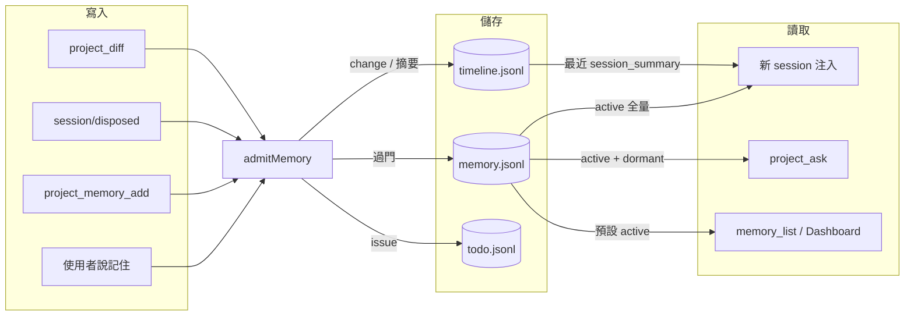
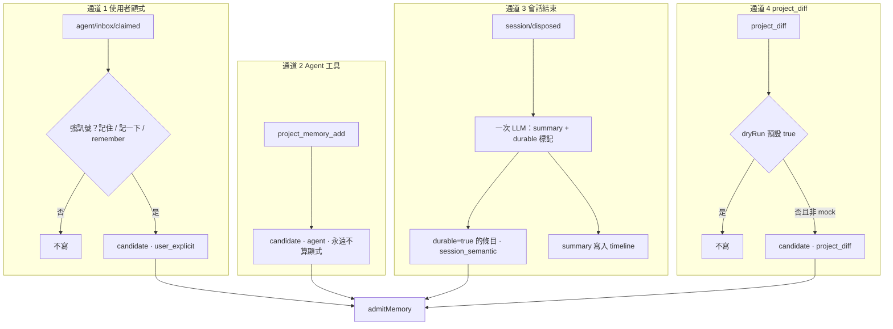
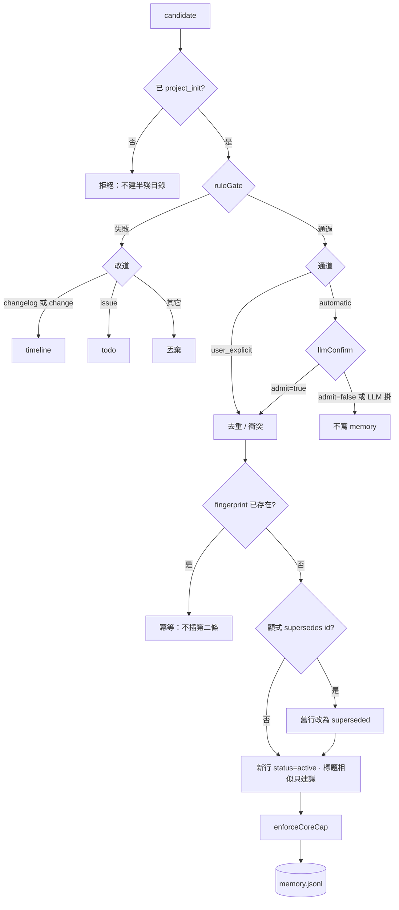
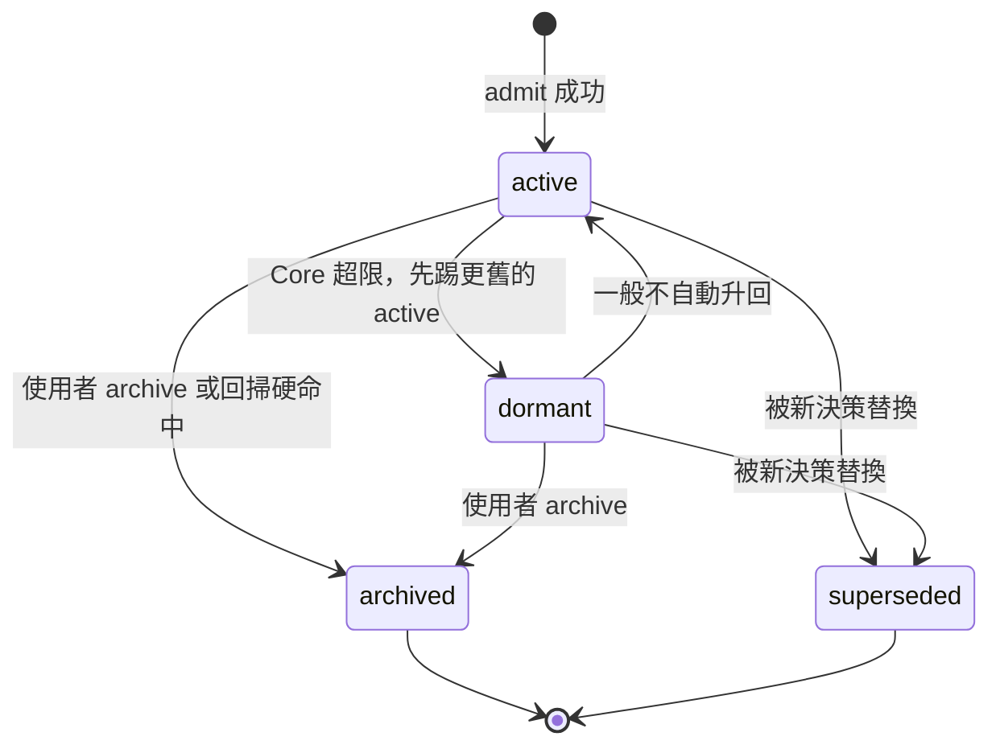
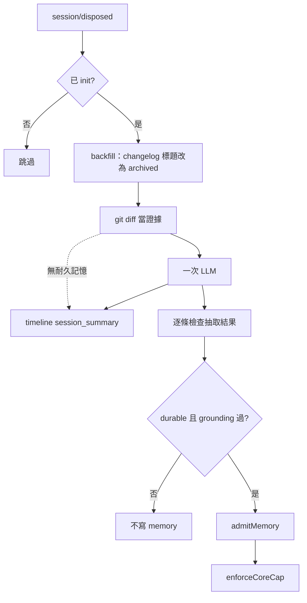
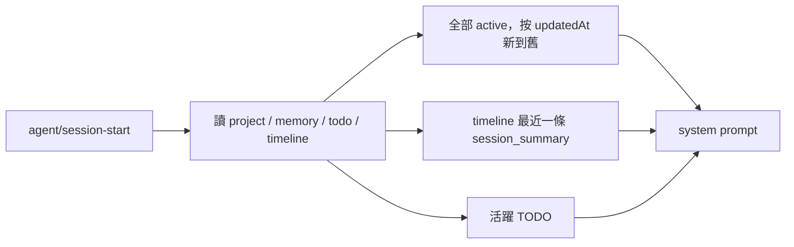
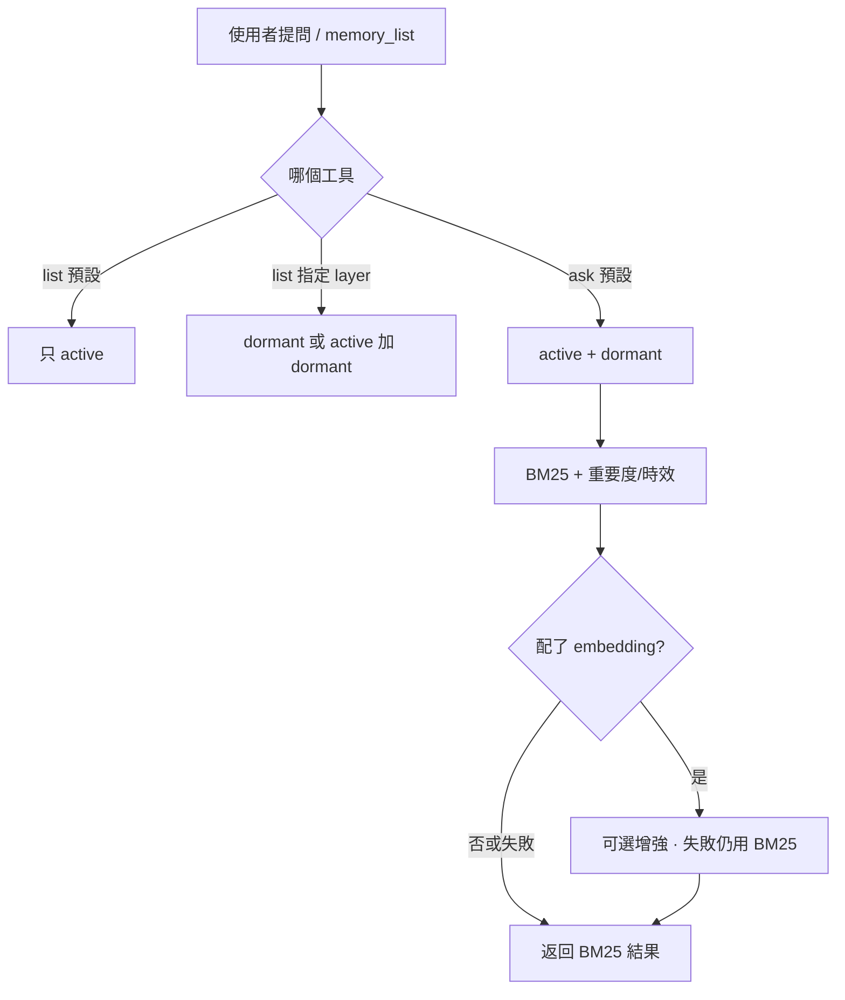
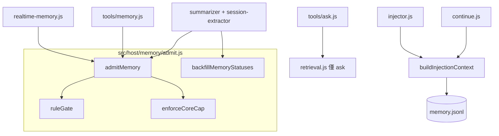
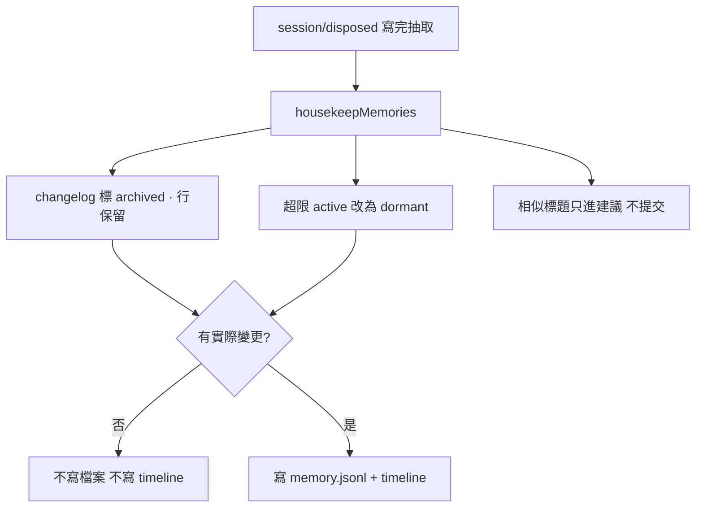

# Durable Core Memory 鏈路圖

對應設計：[2026-09-15-durable-core-memory-design.md](./2026-09-15-durable-core-memory-design.md)

一句話：所有寫入進同一扇門 `admitMemory()`；能進 prompt 的只有 Core（`active`）加上 timeline 裡的上次會話摘要。

---

## 1. 總覽

左邊寫、中間存、右邊讀。**寫 `memory.jsonl` 事實行只有 `admitMemory`。** `project_diff` / 抽取 / 工具 / 記住 全部進這扇門。向量快取是派生資料，注入不用。



---

## 2. 四條寫入通道

只有使用者原話「記住」免 LLM。Agent 工具、會話抽取、`project_diff` 都是自動通道，必須過門。mock 禁止落盤。



弱訊號（以後都 / 約定）**當場不寫**，最多等通道 3 的 LLM 判斷是否耐久。

---

## 3. admitMemory 門

所有通道共用。規則一票否決；LLM 不能推翻規則失敗。



規則門硬拒絕（可單測）：

- type 不在 `decision | requirement | architecture | bug | lesson`（`context` 僅 `user_explicit`）
- 標題/正文像 changelog（版本號、patch、檔案清單、「本次改了 N 個檔案」）
- 正文過短，或整段只是本次活動報告（不是標題裡出現「剛才」就拒絕）

---

## 4. 狀態機

寫入成功後只有排程，沒有「注入時再截斷」。



| status | 含義 | 注入 | ask |
| --- | --- | --- | --- |
| `active` | Core | 全部 | 是 |
| `dormant` | 合格但擠出 Core | 否 | 是 |
| `archived` | 不合格 / 否決 | 否 | 預設否 |
| `superseded` | 已被替換 | 否 | 預設否 |

`archived` ≠ `dormant`：changelog 進 archived；舊但仍為真的決策進 dormant。

---

## 5. 會話結束（summarizer）

Git 只當證據，不再生成 `type=change` 記憶。



---

## 6. 新會話注入

`injector` 和 `project_continue` 共用 `buildInjectionContext()`。不走向量、不做空 query 的 Top-K。



Prompt 結構：

```text
## Project Brain
### 專案概況
### Core 記憶      ← 只 active，全量，寫入時已限 15 / 800 token
### 上次會話      ← 只摘要，不進 memory.jsonl；沒有則整段省略
### 活躍 TODO
```

---

## 7. 按需檢索（ask / list）



注入 **不** 走這張圖。所以不會再出現「list 一套分、prompt 另一套分」。

---

## 8. 模組落點



---

## 9. Dream：只收拾，不刪決策

不是睡覺時再抽一層記憶。會話抽取已經是反射。自動路徑禁止標題相似就刪行。



手動 `project_dream` 預設 dry-run，確認後只執行上圖的歸檔 + evict，仍然不 Jaccard 刪除。

---

## 10. 讀這張圖時記住的三句話

1. **能進 `memory.jsonl` 的，必須像半年後仍為真的句子。** 發版說明、檔案清單、本次改了什麼，只進 timeline。
2. **門在寫入時關死，不在注入時碰運氣。** Core 超限先踢舊的 active；本輪新寫入免驅逐。不合格 → `archived`；只有顯式 supersede 才替換。收拾房間不刪決策。
3. **新 session 只帶 Core + 上次摘要。** 舊決策要回顧，用 `project_ask` 搜 dormant，不要把檔案塞進 system prompt。
