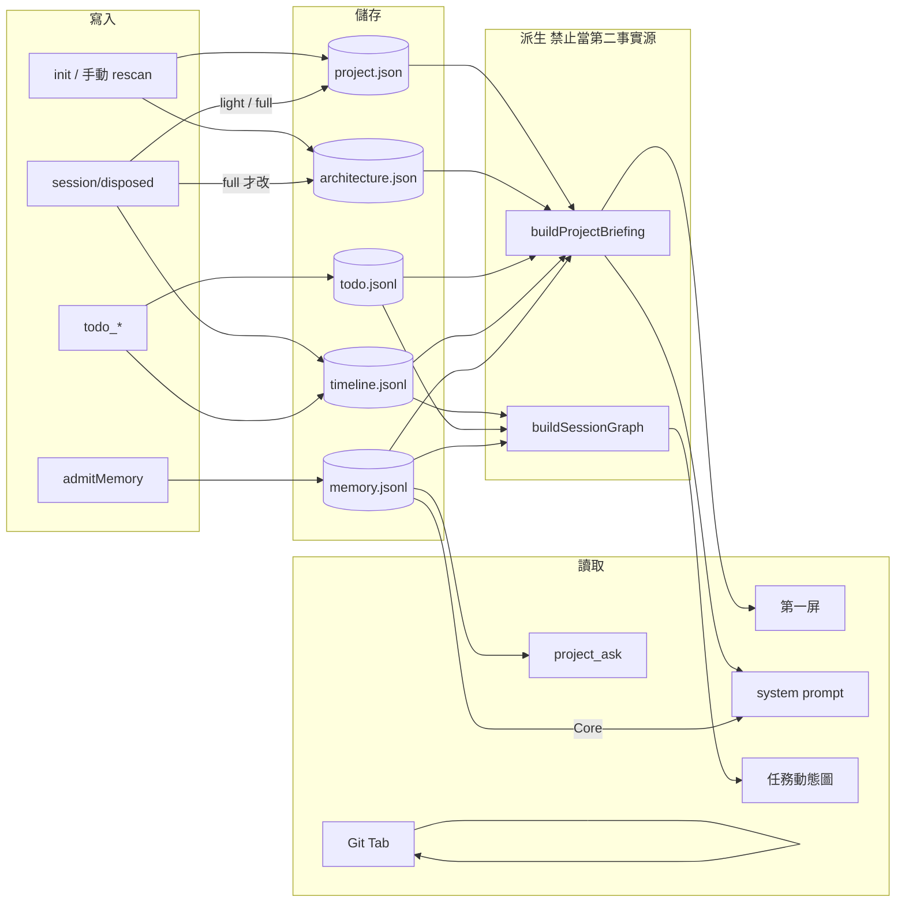
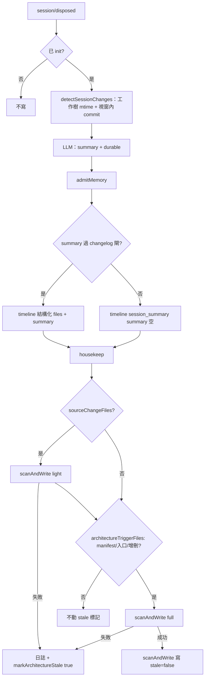
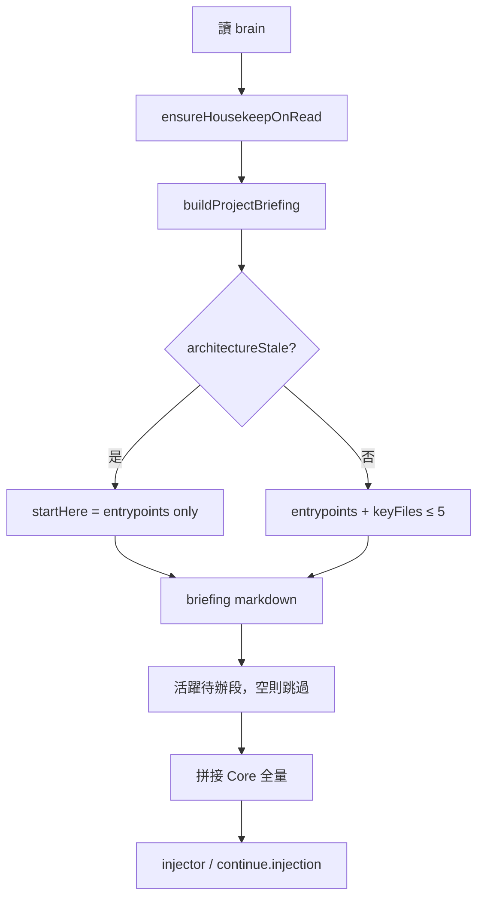
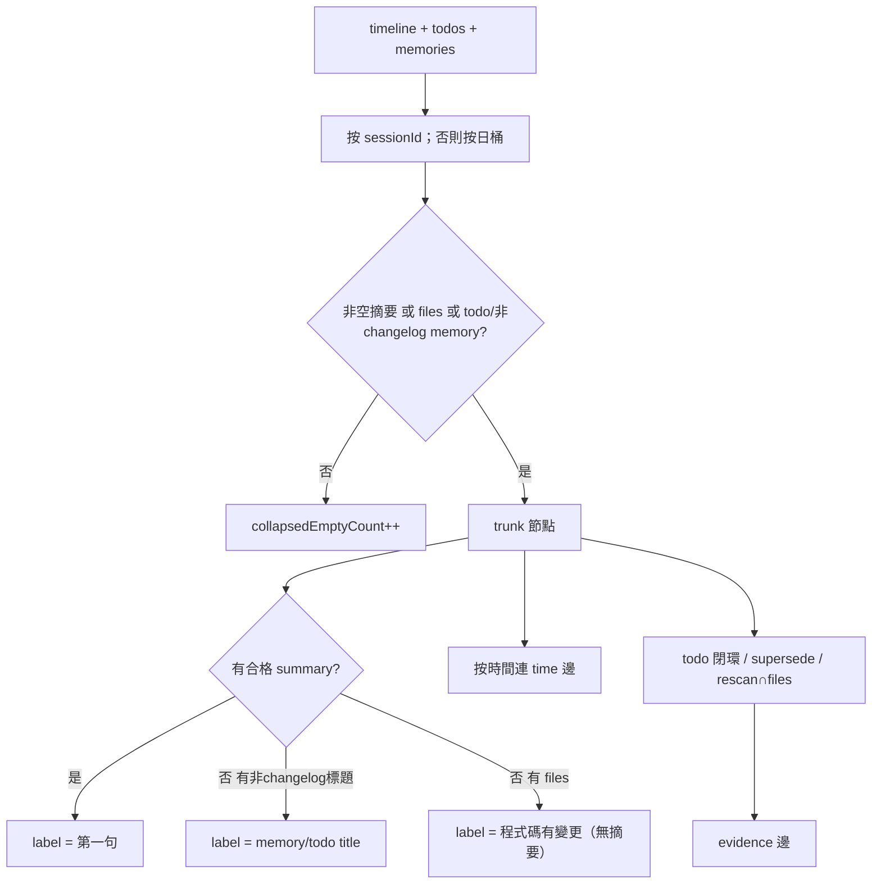

# Project Familiarity 鏈路圖

對應設計：[2026-09-18-project-familiarity-design.md](./2026-09-18-project-familiarity-design.md)

一句話：`.project-brain/` 仍是唯一事實源；人第一屏和 Agent 注入共用 `buildProjectBriefing`；變更史是派生圖，不是新庫。

---

## 1. 讀寫總覽

---

## 2. Session 結束

---

## 3. 注入組裝

---

## 4. 主幹圖派生

